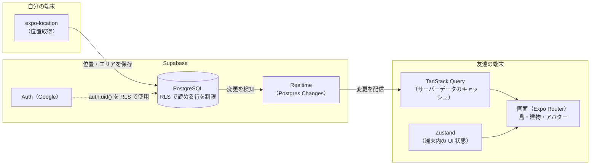

# アーキテクチャ

コードの書き方（命名・状態管理の使い分けなど）は [CODING_GUIDELINES.md](CODING_GUIDELINES.md) を参照。

## 全体像

Expo で作ったアプリが expo-location で位置を取得し、Supabase（PostgreSQL）に保存する。
Realtime で友達の端末に変更が配信され、アプリ内のキャッシュ（TanStack Query）が更新されて画面に反映される。



| 層             | 技術                                  | 役割                                                                          |
| -------------- | ------------------------------------- | ----------------------------------------------------------------------------- |
| 画面           | React Native + Expo / Expo Router     | iOS / Android のアプリ本体。`src/app/` のファイル構成がそのまま画面遷移になる |
| サーバーデータ | TanStack Query                        | Supabase から取得したデータのキャッシュ・再取得                               |
| 端末内の状態   | Zustand                               | 選択中のグループ、開いている建物などの UI 状態                                |
| 位置情報       | expo-location / expo-task-manager     | 位置の取得。バックグラウンド取得は当面使わない                                |
| 入力           | React Hook Form / Zod                 | フォームの状態管理と入力チェック                                              |
| 認証           | Supabase Auth（Google）               | ログイン。ユーザー ID は RLS で `auth.uid()` として使う                       |
| DB             | PostgreSQL（Supabase）                | データの保存。アプリから直接読み書きするため、RLS が権限管理の要              |
| リアルタイム   | Supabase Realtime（Postgres Changes） | テーブルの変更を購読して友達の端末に配信                                      |

> ⚠️ 位置情報の保存形式（エリア ID のみ／緯度経度）と、Realtime を Broadcast と併用するかはまだ決まっていない。
> 決まったら上の図と表を更新すること（[CODING_GUIDELINES.md の未決定事項](CODING_GUIDELINES.md#未決定事項)）。

## ディレクトリ構成

> 🧪 = `create-expo-app` テンプレートのサンプル。本実装に入るときに削除・置き換え予定。
> 🚫 = 自動生成または git 管理外のファイル。手で編集しない／コミットしない。

```
shimanchu/
├── src/                          # アプリのソースコード（import は "@/..." で src/ 起点）
│   ├── app/                      # 画面（Expo Router）。ファイル = 1画面、パス = URL
│   │   ├── _layout.tsx           # ルートレイアウト（全画面共通のナビゲーター・Provider）
│   │   ├── index.tsx             # 🧪 "/" ホーム画面
│   │   └── explore.tsx           # 🧪 "/explore" サンプル画面
│   ├── components/               # 再利用する UI コンポーネント
│   │   ├── ui/
│   │   │   └── collapsible.tsx   # 🧪 開閉パネル
│   │   ├── app-tabs.tsx          # 🧪 タブバー（iOS / Android）
│   │   ├── app-tabs.web.tsx      # 🧪 タブバー（Web 版）
│   │   ├── animated-icon.tsx     # 🧪 アニメーション付きアイコン（*.web.tsx / *.module.css は Web 用）
│   │   ├── themed-text.tsx       # 🧪 ライト/ダーク対応の Text
│   │   ├── themed-view.tsx       # 🧪 ライト/ダーク対応の View
│   │   ├── external-link.tsx     # 🧪 外部リンク（アプリ内ブラウザで開く）
│   │   ├── hint-row.tsx          # 🧪 ヒント表示行
│   │   └── web-badge.tsx         # 🧪 Web 用バッジ
│   ├── constants/
│   │   └── theme.ts              # 🧪 色・フォントなどのテーマ定数
│   ├── hooks/                    # カスタムフック
│   │   ├── use-color-scheme.ts   # 🧪 ライト/ダーク判定（.web.ts は Web 版）
│   │   └── use-theme.ts          # 🧪 現在のテーマ取得
│   ├── lib/                      # 外部サービス接続などの共通処理
│   │   ├── supabase.ts           # Supabase クライアント（認証セッションを AsyncStorage に保存）
│   │   └── query-client.ts       # TanStack Query のクライアント（フォアグラウンド復帰時に再取得）
│   └── global.css                # 🧪 Web 用グローバル CSS
│
├── assets/                       # 画像・アイコン
│   ├── expo.icon/                # iOS 用アプリアイコン
│   └── images/                   # アプリアイコン・スプラッシュ画像・Android アイコン
│                                 #   （react-logo / tabIcons / tutorial-web などは 🧪）
│
├── supabase/                     # Supabase（バックエンド）関連
│   ├── config.toml               # ローカル Supabase の設定（ポート・Auth プロバイダなど）
│   └── .gitignore
│   # 今後 migrations/（DB スキーマ）や seed.sql（初期データ）をここに追加する
│
├── scripts/
│   └── reset-project.js          # 🧪 サンプルを片付けて空のプロジェクトにするスクリプト
│
├── docs/
│   ├── ARCHITECTURE.md           # アーキテクチャ（全体像・データの流れ・ディレクトリ構成）← このファイル
│   ├── SETUP.md                  # 環境構築手順
│   └── CODING_GUIDELINES.md      # コーディング規約（命名・ディレクトリ・状態管理・位置情報など）
├── .github/
│   └── pull_request_template.md  # PR テンプレート
├── CONTRIBUTING.md               # チーム開発ルール（ブランチ・コミット・PR・レビュー）
├── CLAUDE.md                     # Claude Code 向けのプロジェクトルール
│
├── app.json                      # Expo のアプリ設定（アプリ名・アイコン・位置情報の権限文言・プラグイン）
├── package.json                  # 依存パッケージと npm スクリプト
├── package-lock.json             # 依存バージョンの固定（コミットする）
├── tsconfig.json                 # TypeScript 設定（strict、"@/*" → src/* のパスエイリアス）
├── eslint.config.js              # ESLint 設定（Expo 推奨 + Prettier 連携）
├── .prettierrc.json              # Prettier 設定（.prettierignore で対象外を指定）
├── expo-env.d.ts                 # 🚫 Expo の型定義（expo start 時に自動生成）
├── .env.example                  # 環境変数のひな形 → .env.local にコピーして使う
├── .nvmrc                        # Node.js のバージョン指定（nvm use で切り替え）
├── .env.local                    # 🚫 実際の環境変数（各自で作成、コミットしない）
├── .gitignore
├── AGENTS.md                     # AI コーディングエージェント向けのプロジェクトルール
├── .claude/settings.json         # Claude Code の設定（Expo プラグイン有効化）
└── .vscode/                      # VS Code 推奨拡張（Expo Tools・ESLint・Prettier）・保存時の自動整形設定
```

## 自動生成されるディレクトリ（すべて 🚫）

| パス                | 内容                                                                                              |
| ------------------- | ------------------------------------------------------------------------------------------------- |
| `node_modules/`     | `npm install` でインストールされたパッケージ                                                      |
| `.expo/`            | Expo の開発用キャッシュ・型生成物                                                                 |
| `ios/` / `android/` | `npx expo run:ios` 等で生成されるネイティブプロジェクト。設定は `app.json` で行い、直接編集しない |
| `dist/`             | `npx expo export` のビルド成果物                                                                  |

## 配置ルール

- **画面**は `src/app/` に置く。画面以外のコード（コンポーネント・フック・ロジック）は `src/app/` に置かない（ルートとして扱われてしまうため）。
- `*.web.tsx` / `*.web.ts` は Web でのみ使われる実装。同名の `*.tsx` がネイティブ用。
- Supabase など外部サービスとの接続は `src/lib/` にまとめる。
- 今後追加するディレクトリ（`src/api/`・`src/stores/`・`src/schemas/`・`src/tasks/` など）の役割は [CODING_GUIDELINES.md](CODING_GUIDELINES.md#3-ディレクトリ) を参照。
